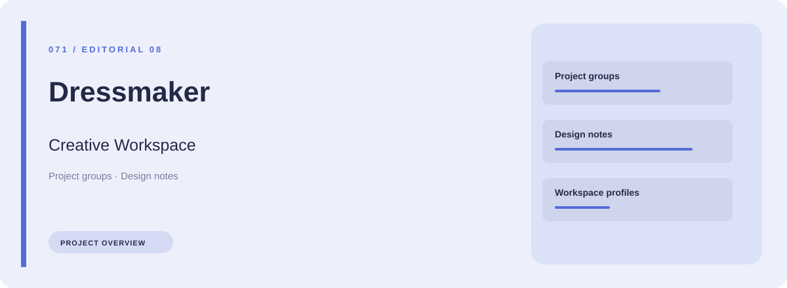
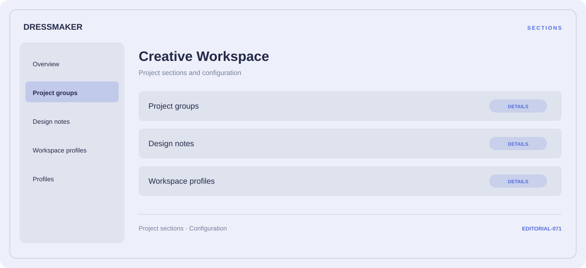

# 🧭 Dressmaker Creative Workspace

**Project groups · Design notes · Workspace profiles**

## ⚡ Features

Dressmaker Creative Workspace groups project groups, design notes, and workspace profiles in a single workspace. Each section keeps its controls and related settings together.

### ⚙️ Project groups

A dedicated section for project groups and the configuration details associated with that area.

### 🧩 Design notes

A dedicated section for design notes and the configuration details associated with that area.

### ⌨️ Workspace profiles

Related settings collected into named groups for a clearer configuration workflow.

## 🖥️ Project navigation

## 📥 Download

The button and cover open the project's download page. Use the information supplied with the downloaded package for installation and release-specific requirements.

## 📚 Project documentation

- [Feature reference](docs/FEATURES.md)
- [Download information](docs/DOWNLOAD.md)
- [Project page](index.html)

---

Dressmaker Creative Workspace · Program documentation and download information.
